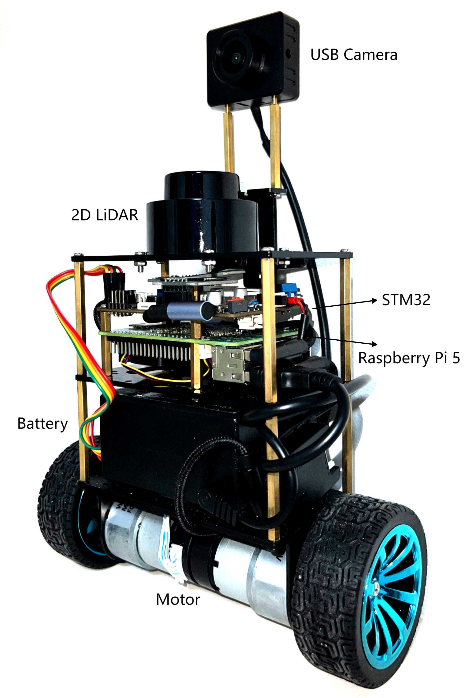
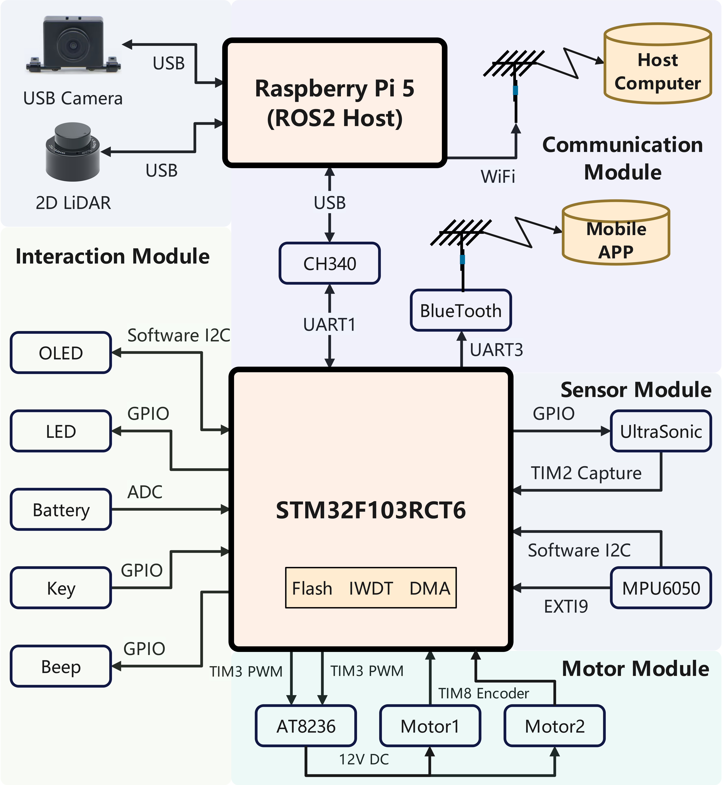
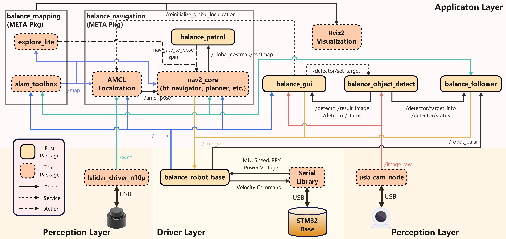

# balance-stm32-rtos

A Two-Wheel Self-Balancing Robot with Edge AI - Codes on Raspberry pi 5


---

## Hardware Selection

<p align="center">
  
</p>

**Main Hardware Components:**

- **Robot Chassis (Lower Computer)**: WheelTec B585 Two-Wheel Self-Balancing Chassis
  - Controller: STM32F103RBT6
  - IMU: MPU6050 Six-Axis Sensor
  - Motors: 2x WheelTec MG513
- **ROS Upper Computer**: Raspberry Pi 5 (8GB RAM)
- **LiDAR**: LSLIDAR N10
- **RGB Camera**: WheelTec C100 USB Camera

---

## Project Introduction

This project implements a two-wheel self-balancing AI robot based on Raspberry Pi 5 and STM32 microcontroller, integrating ROS2 Humble, YOLO26 object detection, target tracking, LiDAR SLAM mapping, and autonomous navigation capabilities. The project uses Docker containerization to deploy ROS2 Humble version, providing complete balance car software packages and configurations, with GUI interface support for quick start and secondary development.

**System Architecture consists of two parts:**

<p align="center">
  
</p>

1. **STM32 lower controller**: handles real-time chassis control, balancing, speed control, and serial communication with the Raspberry Pi.
    - [FreeRTOS version](https://github.com/JordonKwan369/balance-stm32-rtos)
    - [Bare-metal version](https://github.com/JordonKwan369/wheeltec-stm32-bare)

2. **Raspberry Pi 5 upper computer**: runs ROS2, processes vision and LiDAR data, and implements object detection, tracking, SLAM mapping, and navigation.
    - [ROS2 Humble](https://github.com/JordonKwan369/balance-pi5-ros2-humble)

This repository is the ROS2 part on Raspberry Pi 5. The relationship between software packages is as follows:

<p align="center">
  
</p>

---

## Quick Start

### Image Download

Three image files are provided here:

| Image Name | Suitable Capacity | Description | Download Link |
| :--- | :---: | :--- | :---: |
| **Raspberry Pi 5 OS + ROS2 Humble Pure Version**<br>`pi5_os_ros2_humble_pure_64gb.img.gz` | **64 GB** | Contains only clean Raspberry Pi OS (64-bit) and ROS2 Humble Docker container basic environment. **No balance car source code and dependencies**, suitable for deep customization development after unboxing. | [Google Drive](https://drive.google.com/file/d/1Wm0iBsKWKZjdsY2E6NWmJQsd54JVXIZP/view?usp=sharing) |
| **Raspberry Pi 5 OS + Balance Car Complete Version (Final)**<br>`pi5_os_ros2_balance_final_64gb.img.gz` | **64 GB** | Contains complete self-balancing cart ROS2 software packages and dependencies for this project. **Works out of the box**, no additional configuration needed, suitable for direct deployment and operation. | [Google Drive](https://drive.google.com/file/d/1Ztdrhbwqs3eRjeX2pSSa6zOp3crAe3jX/view?usp=sharing) |
| **Raspberry Pi 5 OS + Balance Car Complete Version (Development)**<br>`pi5_os_ros2_balance_dev_128gb.img.gz` | **128 GB** | Provides ample storage space, contains complete balance car software packages and dependencies for this project, suitable for direct deployment and secondary development on Raspberry Pi. | [Google Drive](https://drive.google.com/file/d/1zl_Hebgrv-8edxVrnB0oV0Z2cl5LCXRU/view?usp=sharing) |
| **Raspberry Pi 5 OS + Balance Car Complete Version (Compiled for EE3033)**<br>`pi5_os_ros2_balance_final_64gb.img.gz` | **64 GB** | Contains complete self-balancing cart ROS2 software packages and dependencies for this project. **Works out of the box**, no additional configuration needed, suitable for direct deployment and operation. | [Google Drive](https://drive.google.com/file/d/18KGzGsRUtuQl0qdru07YQ4MMpClEeui0/view?usp=sharing)  |

**Note:** It is recommended to use the official **Raspberry Pi Imager** tool to flash the image.

If using your own Raspberry Pi OS, after installing Docker (refer to official tutorial), you can pull the required ROS2 Humble Base container through `run_humble.sh` (only needed once). This script creates a container and links `/home/balance/ros2_ws` to `/home/ros2_ws` inside the container.

`requirement.txt` records the python pip dependencies to be installed inside the docker container; running the `setup_env.sh` script inside the container can install ROS-related dependencies and packages in one click. Reference commands:
```bash
chmod +x src/setup_env.sh
./src/setup_env.sh
pip3 install -r src/requirements.txt
```

#### STM32 Firmware for EE3033

The following STM32 firmware is designed for use with the  
**Raspberry Pi 5 OS + Balance Car Complete Version (Compiled for EE3033)**.

| Firmware | Target Hardware | Description | Download |
|---|---|---|---|
| **EE3033 Balance Car STM32 Firmware** | STM32 balance-car controller | Precompiled STM32 firmware compatible with the EE3033 Raspberry Pi 5 image. | [Download STM32 Firmware](https://drive.google.com/file/d/1JLcWjwAlCZ2smgtdbEqrrTphuf0mh1_G/view?usp=drive_link) |

> **Important:** Use this STM32 firmware together with the EE3033 Raspberry Pi 5 image to ensure software and communication-protocol compatibility.

### Common Configuration for All Images

1. Initial username: `balance`, initial password: `030609`
2. After power-up, Raspberry Pi automatically creates a hotspot (WPA2 security)
   - Hotspot name: `self_balance`
   - Password: `20030609`
3. After connecting to the network, it is recommended to use VNC for visual desktop
   - Software: realVNC
   - Username: `balance.local`
   - Password: `030609`
4. ROS2 container working directory
   - Inside container: `/home/ros2_ws`
   - Outside container: `/home/balance/ros2_ws` (linked)
5. Container control commands
   - Enter container: `ros2-start`
   - Stop container: `ros2-stop`
6. Environment configuration
   - Container `~/.bashrc` has ROS environment variables added:
```bash
source /opt/ros/humble/setup.bash
if [ -f "/home/ros2_ws/install/setup.bash" ]; then
    source /home/ros2_ws/install/setup.bash
fi
```

### For Pure Version Image

1. No source code for this project in workspace
2. ROS2 container only contains basic ROS2 environment, project dependencies not installed

### For Complete Version Image

1. Enter container: `ros2-start`
2. Enter workspace: `cd /home/ros2_ws`
3. Build packages
   - Build all packages: `colcon build --symlink-install`
   - **Recommended first**: build `balance_interface`
   - Build specific package: `colcon build --symlink-install --packages-select <package_name>`
   - Refresh environment after build: `source install/local_setup.sh`
4. Launch GUI: `ros2 launch balance_gui balance_gui.launch.py`
5. NFS mount working directory: `sudo mount -t nfs balance.local:/home/balance/ros2_ws <local_directory>`

### Notes
1. This project uses LSLIDAR N10P LiDAR. If using other models from the same brand, you need to modify the radar name in the configuration file (`params/lsn10p.yaml`) in the `LSLIDAR_N10P_ROS2` package.
2. When using the PID tuning function in the GUI interface, please **hold the cart**; if you find that the cart is unstable after writing to Flash, please restart the cart to restore it.
3. When enabling the `balance_robot_base` package, the STM32 will automatically reset due to the serial port RTS pin. Please hold the cart when starting the `balance_robot_base` node.

---

<details>
<summary><h2>Software Package Usage</h2></summary>

### 1. balance_robot_base

`balance_robot_base` is the core chassis package of the entire self-balancing cart system. All motion-related nodes depend on this package. It is responsible for communicating with the lower computer (STM32 controller) via serial port to exchange speed commands and sensor data.

#### Launch Methods

**Method 1: Using Command**
```bash
ros2 launch balance_robot_base balance_robot_base.launch.py
```

**Method 2: GUI Interface**
After opening the GUI node, click `Open STM32 Controller` to directly launch the node.

#### Configuration Description
The chassis parameter configuration file is located at `config/base_params.yaml`. Main parameters include:

| Parameter Name | Description | Default Value |
|------|------|--------|
| `control_loop_freq` | Control loop frequency (Hz) | 50.0 |
| `usart_port_name` | Serial device path | /dev/balance_controller |
| `serial_baud_rate` | Serial baud rate | 115200 |
| `odom_frame_id` | Odometry coordinate frame name | odom_combined |
| `robot_frame_id` | Robot chassis coordinate frame name | base_footprint |
| `enable_s_curve` | Enable S-curve smoothing | true |
| `max_accel_x` | X-axis linear velocity max acceleration (m/s²) | 0.3 |
| `max_accel_z` | Z-axis angular velocity max acceleration (rad/s²) | 3.0 |

#### Troubleshooting

**Unable to connect to serial port:**

- Check device connection: `ls /dev/balance_controller`
- If not found, run `bash balance_udev.sh` to configure udev rules
- Same applies for LiDAR and USB camera

---

### 2. balance_usb_cam

`balance_usb_cam` contains only configuration files for USB camera (providing two preset configuration modes: default and detector), serving as launch configuration for the third-party USB camera driver package `usb_cam`.

Install `usb_cam` package: `sudo apt install ros-humble-usb-cam`. This package provides ROS2 interface support for USB cameras, enabling video stream collection and publishing as ROS2 topics.

#### Launch Methods

**Method 1: Using Command**
```bash
ros2 launch balance_usb_cam usb_cam.launch.py mode:=default
```

**Method 2: GUI Interface**
After opening the GUI node, click `Open USB Camera` to directly launch the camera node.

#### Configuration Description
Configuration files are located in the `config/` directory:

| Filename | Purpose | Applicable Scenario |
|------|------|---------|
| `camera_params_default.yaml` | Default configuration (30fps) | Real-time vision processing, stream media transmission |
| `camera_params_detector.yaml` | Detector configuration (10fps) | Object detection, target tracking, reduce computation load |
| `camera_info.yaml` | Camera intrinsic calibration | Image undistortion, 3D vision computation |

**Main Parameters:**

| Parameter Name | Description | Default Value |
|------|----------|----------|
| `video_device` | Camera device number | /dev/video0 |
| `framerate` | Image frame rate (fps) | 30.0 |
| `image_width` | Image width (pixels) | 640 |
| `image_height` | Image height (pixels) | 480 |
| `pixel_format` | Pixel format | mjpeg2rgb |
| `camera_name` | Camera name | usb_cam |

---

### 3. LSLIDAR_N10P_ROS2

`LSLIDAR_N10P_ROS2` is the ROS2 driver package for LSLIDAR N10P LiDAR, responsible for communicating with the radar via serial port or network interface to collect and publish laser point cloud data. This package supports multiple LiDAR models and provides flexible configuration mechanisms.

#### Launch Methods

**Method 1: Launch Single LiDAR**
```bash
ros2 launch lslidar_driver_n10p lslidar_launch.py
```

**Method 2: Via GUI Interface**
After opening the GUI node, click `Open Laser Radar` to directly launch the single LiDAR node.

#### Configuration Description
Configuration file is located at `params/lsn10p.yaml`. Main parameters are as follows:

| Parameter Name | Description | Default Value | Remarks |
|------|------|--------|------|
| `lidar_name` | LiDAR model | N10_P | Supported: M10, M10_P, M10_PLUS, M10_GPS, N10, L10, N10_P |
| `interface_selection` | Communication interface | serial | Optional: net(network), serial(serial port) |
| `serial_port_` | Serial device number (serial mode) | /dev/balance_lidar | Auto-configured via udev rules |
| `frame_id` | Laser coordinate frame name | laser | Used for TF transform |
| `scan_topic` | Scan topic name | /scan | 2D laser scan data |
| `pointcloud_topic` | Point cloud topic name | /lslidar_point_cloud | 3D laser point cloud data |
| `angle_disable_min` | Angle cropping start value | 120.0 | degrees |
| `angle_disable_max` | Angle cropping end value | 240.0 | degrees |
| `min_range` | Minimum receive distance | 0.0 | meters |
| `max_range` | Maximum receive distance | 200.0 | meters |
| `pubScan` | Whether to publish Scan topic | true | - |
| `pubPointCloud2` | Whether to publish PointCloud2 topic | false | - |

---

### 4. balance_interface

`balance_interface` is a low-level custom message and service interface definition package that defines all custom topics and services required for communication between nodes in the entire balance car system. This package does not contain executable nodes, but provides unified data structure definitions for other packages.

**Main Interfaces Include:**
- **PIDParams Message**: Publish PID parameters of balance car STM32 controller (balance, speed, steering)
- **PIDCommand Message**: Send PID parameter settings command to chassis
- **TargetInfo Message**: Object detection results (target position in image, similarity, etc.)
- **SetTarget Service**: Set target image for the cart to follow

---

### 5. balance_object_detect

#### Feature Description

`balance_object_detect` is a deep learning-based object detection and tracking system that integrates YOLO26 object detection model and two lightweight feature extraction models (person ReID feature extraction and generic object feature extraction), achieving real-time multi-object detection, specific target tracking, and online feature learning.

#### Launch Methods

**Method 1: Using Command**

- Launch with default configuration
```bash
ros2 launch balance_object_detect balance_object_detector.launch.py
```

- Launch with custom model
```bash
ros2 launch balance_object_detect balance_object_detector.launch.py \
  yolo_model:=yolo26s.pt \
  reid_model:=osnet_x1_0 \
  generic_model:=mobilenet_v3_large
```

- Set tracking target
```bash
ros2 run balance_object_detect test_object_detect_client /path/to/target.jpg
```

**Method 2: Via GUI Interface**

**Feature Launch**

After opening the GUI node, click `Open Person/Object Recognization` to directly launch the object detection node, which will also pull up dependent nodes (USB camera node).

**Set Tracking Target**

In the GUI interface, click the `Set Target` button, select target image file to set tracking target; you can also click candidate targets (red boxes) in the video stream directly; click `Reset Target` to clear current tracking target.

#### Configuration Description
Configuration file is located at `config/params_detector.yaml`. Main parameters are as follows:

| Parameter Name | Description | Optional Values/Default | Remarks |
| :--- | :--- | :--- | :--- |
| **Model Selection Parameters** |  |  |  |
| `yolo_model` | YOLO detection model | yolo26n/26s/26m/26l | Larger = higher accuracy, slower speed |
| `reid_model` | Person Re-ID model | osnet_x0_25/x0_5/x0_75/x1_0 | Larger = finer features, slower speed |
| `generic_model` | Generic object feature | mobilenet_v3_small/large | large = higher accuracy, small = faster speed |
| **Matching and Tracking Thresholds** |  |  |  |
| `conf_thres` | YOLO detection confidence threshold | 0.3 | 0.1~0.9 |
| `person_match_thres` | Person matching similarity threshold | 0.65 | 0.0~1.0 |
| `object_match_thres` | Generic object matching threshold | 0.65 | 0.0~1.0 |
| `learning_thres` | Feature learning/update threshold | 0.80 | 0.0~1.0 |
| **Tracking and Loss Handling** |  |  |  |
| `track_method` | Target loss prediction | kalman | Optional: none(no prediction), kalman(Kalman) |
| `lost_timeout` | Blind flight/prediction buffer time | 1.0 | seconds |
| `reset_timeout` | Timeout reset duration | 10.0 | seconds |
| `feature_update_rate` | Feature fusion learning rate | 0.05 | 0.0~1.0 |
| `max_bank_size` | Negative sample blacklist capacity | 5 | 0 to disable |
| `negative_ttl` | Blacklist item TTL | 20.0 | seconds |
| **Image Processing Parameters** |  |  |  |
| `expand_ratio` | Detection box expansion ratio | 0.10 | Expand black area outside detection box |
| `enable_point_undistortion` | Enable single-point distortion correction | True | USB camera has distortion |
---

### 6. balance_follower

`balance_follower` implements multimodal target tracking based on vision and LiDAR, enabling the cart to automatically follow detected targets (people or objects). This package uses PID control algorithm to convert target position deviation provided by camera and distance information provided by LiDAR into velocity commands, and sends commands to the chassis node.

#### Launch Methods

**Method 1: Command Line**
```bash
ros2 launch balance_follower balance_mixed_follower.launch.py
```

**Method 2: GUI Interface**

After opening the GUI node, click `Open Mixed Follower` to directly launch target tracking, which will also pull up dependent nodes (object detection node, LiDAR node, USB camera node, chassis node).

#### Configuration Description
Configuration file is located at `config/params_mixed.yaml`. Main parameters are as follows:

| Parameter Name | Description | Default Value | Remarks |
|------|------|--------|------|
| `camera_fov_deg` | Camera field of view (degrees) | 96.0 | C100 camera 4:3 ratio; 16:9 is 112.0 |
| `target_distance` | Expected distance to maintain from target | 0.30 | meters |
| `scan_window_deg` | Laser search window in target direction | 12.0 | degrees |
| `lost_timeout` | Stop after target disappears for n seconds | 1.5 | seconds |
| `max_linear_x` | Maximum forward linear velocity | 0.3 | m/s |
| `min_linear_x` | Maximum backward linear velocity | -0.3 | m/s |
| `max_angular_z` | Maximum steering angular velocity | 1.5 | rad/s |

---

### 7. balance_mapping

`balance_mapping` package: Based on SLAM Toolbox library, provides configuration and launch files for SLAM mapping; based on explore_lite library, provides configuration and launch files for automatic exploration mapping. Supports both asynchronous and synchronous SLAM mapping modes, with parameter configuration provided.

#### Launch Methods

**Method 1: Command Line**

```bash
# Asynchronous SLAM mapping
ros2 launch balance_mapping balance_mapping_slamtoolbox_async.launch.py
# Synchronous SLAM mapping
ros2 launch balance_mapping balance_mapping_slamtoolbox_sync.launch.py
# Autonomous exploration mapping
ros2 launch balance_mapping balance_explorer_lite.launch.py
# Save map
ros2 service call /slam_toolbox/save_map slam_toolbox/srv/SaveMap \
  "{name: {data: /home/ros2_ws/my_map}}"
```

**Method 2: GUI Interface**

After opening the GUI node, you can select mapping method (asynchronous SLAM, synchronous SLAM, autonomous exploration), then click `Open Mapping` to launch mapping, which will automatically pull up dependent nodes.

Click `Save Map` to save current map. Map files will be saved in `./src/balance_mapping/maps/` directory.

**Note:** When map boundaries are too fragmented during mapping, explore_lite node may stop early. In this case, you can click `Open Explore` to restart exploration.

#### Key Configuration Description

**SLAM Parameters** (`config/mapper_params_online_async.yaml`):

| Parameter Name | Description | Default Value | Remarks |
| :--- | :--- | :---: | :---: |
| `resolution` | Map resolution (meters/pixel) | 0.05 | - |
| `max_laser_range` | Maximum laser effective distance (meters) | 8.0 | - |
| `map_update_interval` | Map update interval (seconds) | 1.5 | - |
| `minimum_travel_distance` | Keyframe minimum travel distance (meters) | 0.25 | - |
| `do_loop_closing` | Enable loop closure detection | true | - |
| `loop_search_maximum_distance` | Loop closure maximum search distance (meters) | 3.0 | - |

**Autonomous Exploration Parameters** (`config/explore_params.yaml`):

| Parameter Name | Description | Default Value | Remarks |
| :--- | :--- | :---: | :---: |
| `planner_frequency` | Replanning frequency (Hz) | 0.2 | - |
| `progress_timeout` | Stuck timeout (seconds) | 15.0 | - |
| `min_frontier_size` | Minimum frontier width (meters) | 0.12 | - |
| `gain_scale` | Exploration priority weight | 2.0 | - |

---

### 8. balance_navigation

`balance_navigation` integrates ROS2 Nav2 navigation framework, providing configuration and launch files for `Navigation2` core, AMCL localization, and autonomous patrol functionality.

#### Launch Methods

**Method 1: Command Line**

```bash
# Launch AMCL localization
ros2 launch balance_navigation balance_amcl_localization.launch.py map:=/path/to/map.yaml

# Launch complete navigation stack simultaneously
ros2 launch balance_navigation balance_nav2_core.launch.py

# Launch random patrol (random target points)
ros2 launch balance_navigation balance_patrol.launch.py strategy:=random

# Launch spinning patrol in place
ros2 launch balance_navigation balance_patrol.launch.py strategy:=spin
```

**Method 2: GUI Interface**

After opening the GUI node, click `Open Navigation (Nav2)` to launch Nav2 core functionality, which will automatically pull up dependent nodes (LiDAR node, chassis node).

Click `Open Localization (AMCL)` to begin localization; in the GUI interface you can select different patrol strategies, then click `Open Patrol` to begin autonomous patrol.

**Note:** These two functionalities require a map file to be provided.

#### Key Configuration Description

**AMCL Localization Parameters** (`config/localization_params.yaml`):

| Parameter Name | Description | Default Value | Remarks |
|------|------|--------|------|
| `alpha1~5` | Odometry error parameters (motion model) | 0.2 | 0.0~1.0 |
| `base_frame_id` | Robot base coordinate frame | base_footprint | - |
| `global_frame_id` | Global map coordinate frame | map | - |
| `odom_frame_id` | Odometry coordinate frame | odom_combined | - |
| `scan_topic` | Laser scan topic | /scan | - |
| `max_particles` | Maximum particles | 2000 | 500~5000 |
| `min_particles` | Minimum particles | 500 | 100~1000 |
| `pf_err` | Particle filter error threshold | 0.05 | 0.01~0.1 |
| `pf_z` | Particle filter parameter z | 0.99 | 0.0~1.0 |

**Nav2 Navigation Parameters** (`config/nav2_core_params.yaml`):

**Global Planning:**

| Parameter Name | Description | Default Value |
|------|------|--------|
| `global_frame` | Global map coordinate frame | map |
| `robot_base_frame` | Robot base coordinate frame | base_footprint |
| `bt_loop_duration` | BT execution period | 10 |

**Local Planning (DWB):**

| Parameter Name | Description | Default Value |
|------|------|--------|
| `controller_frequency` | Control frequency | 20.0 |
| `min_vel_x` | Minimum forward velocity | -0.05 |
| `max_vel_x` | Maximum forward velocity | 0.25 |
| `max_angular_z` | Maximum angular velocity | - |
| `xy_goal_tolerance` | XY goal tolerance | 0.15 |
| `yaw_goal_tolerance` | Yaw goal tolerance | 0.25 |

**Path Planning Weights:**

| Critic | Weight | Function |
|------|------|------|
| RotateToGoal | 32.0 | Prioritize aligning to goal direction |
| PathAlign | 64.0 | Maintain path alignment |
| GoalAlign | 24.0 | Align when approaching goal |
| PathDist | 16.0 | Path distance evaluation |
| GoalDist | 24.0 | Goal distance evaluation |
| BaseObstacle | 0.05 | Collision cost (small weight to prevent over-avoidance) |

---

### 9. balance_dependencies

`balance_dependencies` is a dependency management package containing multiple open-source libraries to support project functionality. Contains:
- **m-explore-ros2**: Explore Lite autonomous exploration framework for autonomous mapping
- **serial_ros2**: Serial communication library for communicating with STM32 lower-level controller

The dependency library code integrated in this package comes from the open-source community and has been adapted for ROS 2 Humble.

---

### 10. balance_gui

`balance_gui` is a cross-platform desktop application based on Qt5, providing complete robot control, monitoring, and debugging functionality. The application can be launched locally on Raspberry Pi; it can also run on other ROS hosts in the same LAN as Raspberry Pi, controlling nodes on Raspberry Pi via SSH command publishing.

#### Launch Methods

**1. Local Launch (on Raspberry Pi)**
```bash
ros2 launch balance_gui balance_gui.launch.py
```

**2. Remote Launch (on other ROS hosts in the same LAN)**

Need to configure environment variables pointing to Raspberry Pi's ROS_DOMAIN_ID:
```bash
ros2 launch balance_gui balance_gui.launch.py use_ssh:=true use_docker:=true \
  remote_user:=balance remote_pwd:=<password>
```

#### Configuration Parameters

**launch file parameters** (`launch/balance_gui.launch.py`):

| Parameter Name | Default Value | Description |
|------|--------|------|
| `use_ssh` | false | Whether to enable SSH remote control |
| `remote_ip` | balance.local | Raspberry Pi IP or hostname |
| `remote_user` | balance | SSH username |
| `remote_pwd` | PWD_030609 | SSH password (encrypted storage) |
| `use_docker` | false | Whether to use Docker environment |
| `docker_name` | ros2_humble | Docker container name |
| `local_pwd` | dongguan | Local working directory (for NFS mount) |

#### Feature Details

**1. Real-time Monitoring Panel**

- **Video Display Area** (select `Image`): Display selected image topic in video mode, support mouse click to select target, support screenshot save of current frame
- **Topic Text Display Area** (select `Topic`): Display selected text topic content
- **Voltage Monitoring**: Battery voltage display
- **Sensor Data**: X linear velocity and Z angular velocity (motor encoder), three-axis angular velocity (gyroscope), RPY angles, position odometry

**2. Remote Control Module**

Two input modes, real-time send `/cmd_vel` commands:

- Numpad button layout corresponding to keyboard keys
- Continuous speed command when pressed, stop when released
- Slider adjustment of target linear and angular velocity
- Check "smooth acceleration" to enable acceleration limit

**3. PID Parameter Adjustment**

Support adjusting PID parameters of three independent control loops on STM32:

1. Click "Get Params" to get current hardware parameters
2. Modify target values in SpinBox
3. Click individual "Set" button or "Set All" to send new parameters
4. Test effect, repeat adjustment
5. Click "Save to Flash" to permanently save parameters

**4. Software Package Function Management**

- Each functional module (chassis, camera, radar, detection, tracking, mapping, navigation) has independent launch button, automatically pulling up dependent nodes when launched
- Green indicates running, white indicates not running
- GUI restart automatically detects running status of each node and updates display

**5. Logs and Diagnostics**

**Log Display Area**

- Black for normal messages, red for errors/warnings
- Maximum 1000 lines of logs retained

**Connection Status Indicator**

- **Offline (Offline)**: Red, unable to connect to ROS system
- **Online (Online)**: Green, connected to ROS2 node network

---

</details>

<details>
<summary><h2>Serial Communication Protocol between Raspberry Pi 5 and STM32</h2></summary>

This project uses serial port (USART) for communication between Raspberry Pi and STM32:

- **Baud Rate**: 115200 bps
- **Data Bits**: 8 bits
- **Stop Bits**: 1 bit
- **Parity**: None

### STM32 → ROS2

#### Sensor Data Frame `{D:...}`

Used for STM32 to periodically send sensor data to ROS2 (fixed length 32 bytes).

**Frame Structure:**

| Byte Position | Field Name | Length | Data Type | Description |
|------|--------|------|---------|------|
| [0] | Frame Header | 1 | uint8_t | 0x7B ('{') |
| [1] | Frame ID | 1 | char | 'D' |
| [2] | Reserved | 1 | - | ':' |
| [3] | Motor Stop Flag | 1 | uint8_t | 0: normal, 1: motor stopped |
| [4-5] | X Axis Velocity | 2 | int16_t (BE) | Odometry X velocity (mm/s) |
| [6-7] | Y Axis Velocity | 2 | int16_t (BE) | Odometry Y velocity (mm/s) |
| [8-9] | Z Axis Angular Velocity | 2 | int16_t (BE) | Odometry Z angular velocity (mrad/s) |
| [10-11] | Acceleration X | 2 | int16_t (BE) | Acceleration X (same unit as raw IMU) |
| [12-13] | Acceleration Y | 2 | int16_t (BE) | Acceleration Y |
| [14-15] | Acceleration Z | 2 | int16_t (BE) | Acceleration Z |
| [16-17] | Gyroscope X | 2 | int16_t (BE) | Angular velocity X |
| [18-19] | Gyroscope Y | 2 | int16_t (BE) | Angular velocity Y |
| [20-21] | Gyroscope Z | 2 | int16_t (BE) | Angular velocity Z |
| [22-23] | Voltage | 2 | int16_t (BE) | Battery voltage (mV) |
| [24-25] | Pitch Angle | 2 | int16_t (BE) | Pitch angle (unit /100 degrees) |
| [26-27] | Roll Angle | 2 | int16_t (BE) | Roll angle (unit /100 degrees) |
| [28-29] | Yaw Angle | 2 | int16_t (BE) | Yaw angle (unit /100 degrees) |
| [30] | Checksum | 1 | uint8_t | XOR checksum (first 31 bytes) |
| [31] | Frame Tail | 1 | uint8_t | 0x7D ('}') |

#### PID Parameter Echo Frame `{P:$:...}`

STM32 returns current PID parameters after receiving PID parameter query command (variable-length text frame).

**Frame Format:**
```
{P:$:kp_balance:kd_balance:kp_velocity:ki_velocity:kp_turn:ki_turn:kd_turn:kp_distance:kd_distance:mid_angle}
```

**Parameter Description:**

| Parameter | Name | Unit | Scale Factor |
|------|------|------|---------|
| `kp_balance` | Balance PID-P | - | ÷100 |
| `kd_balance` | Balance PID-D | - | ÷100 |
| `kp_velocity` | Velocity PID-P | - | ÷1000 |
| `ki_velocity` | Velocity PID-I | - | ÷1000 |
| `kp_turn` | Steering PID-P | - | ÷1000 |
| `ki_turn` | Steering PID-I | - | ÷1000 |
| `kd_turn` | Steering PID-D | - | ÷1000 |
| `kp_distance` | Distance PID-P | - | ÷100 |
| `kd_distance` | Distance PID-D | - | ÷100 |
| `mid_angle` | Mechanical Mid-value | ° | ÷10 |

### ROS2 → STM32

#### Velocity Command Frame `{S:...}`

ROS2 sends motion velocity commands to STM32 (fixed length 11 bytes).

**Frame Structure:**

| Byte Position | Field Name | Length | Data Type | Description |
|------|--------|------|---------|------|
| [0] | Frame Header | 1 | uint8_t | 0x7B ('{') |
| [1] | Frame ID | 1 | char | 'S' |
| [2] | Reserved | 1 | - | ':' |
| [3-4] | X Axis Velocity | 2 | int16_t (BE) | Forward velocity (mm/s) |
| [5-6] | Y Axis Velocity | 2 | int16_t (BE) | Lateral velocity (mm/s, not used for now) |
| [7-8] | Z Axis Angular Velocity | 2 | int16_t (BE) | Steering angular velocity (mrad/s) |
| [9] | Checksum | 1 | uint8_t | XOR checksum (first 9 bytes) |
| [10] | Frame Tail | 1 | uint8_t | 0x7D ('}') |

#### PID Parameter Setting Frame {P:...}

ROS2 sends PID parameter modification command to STM32.

**Get Current Parameters:**
```
{P:GET}
```

**Save Parameters to Flash:**
```
{P:SAVE}
```

**Batch Set All Parameters:**
```
{P:#:kp1:kd1:kp2:ki2:kp3:ki3:kd3:kp4:kd4:mid_ang}
```

Parameters are the same as echo frame, scale factors are the same.

**Set Individual Parameter:**
```
{P:param_id:scaled_value}
```

**Reload Saved Parameters from Flash:**
```
{P:RESET}
```
Note: Reloads the currently saved Flash parameters into RAM. If Flash parameters are invalid, factory defaults are loaded into RAM without writing Flash.

**Restore Factory Defaults and Save to Flash:**
```
{P:FACTORY}
```
Note: Loads the code-defined factory defaults into RAM and writes them to Flash immediately.

---

</details>
